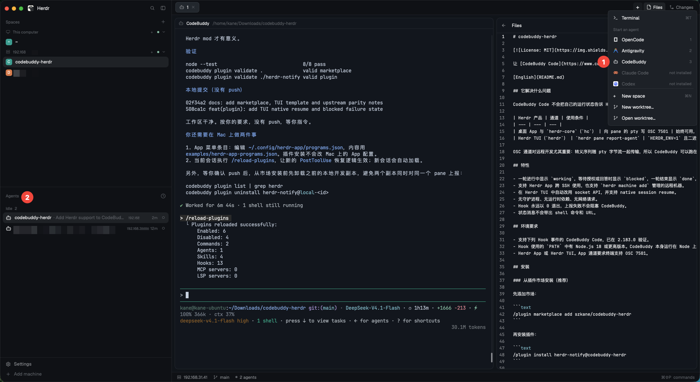

# codebuddy-herdr

[](LICENSE)

Make [CodeBuddy Code](https://www.codebuddy.ai/) a first-class agent in [Herdr](https://herdr.dev/): live `working`, `blocked` and `done` states in the sidebar, plus notifications when a turn finishes or needs you.

[中文文档](README.zh-CN.md)



## What it does

CodeBuddy Code does not report its state to Herdr. This plugin wires CodeBuddy's lifecycle hooks to the transports Herdr actually reads:

| Herdr product | Transport | When it is used |
| --- | --- | --- |
| Desktop app and `herdr-core` (`hc`) | OSC 7501 on the pane's pty | Always available; works over SSH |
| Herdr TUI (`herdr`) | `herdr pane report-agent` | When `HERDR_ENV=1` points at the TUI binary |

The OSC path matters for remote work: terminal escape sequences travel with the pty byte stream, so CodeBuddy can run on a remote Linux machine while the Herdr app runs on your Mac. Nothing has to be installed on the Mac.

## Features

- Reports `working` while a turn runs, `blocked` while CodeBuddy waits for permission or an answer, and `blocked` when a turn fails.
- Works with the Herdr app over SSH, and with remote machines managed by `herdr machine add`.
- Uses the Herdr TUI socket API when running inside the TUI, including native session resume.
- No daemon, no runtime dependencies, no network calls.
- Hooks always exit 0. A reporting failure can never block an agent turn.
- Keeps prompts, shell commands, URLs and MCP text out of the status message.

## Requirements

- CodeBuddy Code with the hook events listed below. Tested with 2.183.0.
- Node.js 18 or newer on the `PATH` used by hooks. CodeBuddy itself runs on Node; `scripts/notify.sh` also checks common install locations.
- Herdr app or Herdr TUI. The app path requires OSC 7501 support.

## Install

### From the plugin marketplace (recommended)

Add the marketplace once:

```text
/plugin marketplace add szkane/codebuddy-herdr
```

Then install the plugin:

```text
/plugin install herdr-notify@codebuddy-herdr
```

Or do both from the shell:

```bash
codebuddy plugin marketplace add szkane/codebuddy-herdr
codebuddy plugin install herdr-notify@codebuddy-herdr --scope user
```

Start a new CodeBuddy session, or run `/reload-plugins` in the current one.

You can also run `/plugin`, open **Discover**, select **herdr-notify**, and choose an install scope.

Update later:

```bash
codebuddy plugin marketplace update codebuddy-herdr
codebuddy plugin update herdr-notify@codebuddy-herdr
```

### From a local checkout

For plugin development:

```bash
git clone https://github.com/szkane/codebuddy-herdr.git
codebuddy --plugin-dir ./codebuddy-herdr/herdr-notify
```

Or install the checkout as a local marketplace:

```bash
cd codebuddy-herdr
codebuddy plugin marketplace add .
codebuddy plugin install herdr-notify@codebuddy-herdr --scope user
```

### Verify

```bash
codebuddy plugin list | grep herdr
```

> If you previously loaded this repository with `--plugin-dir` or installed it as a local package, uninstall that copy before installing from the marketplace. Two enabled copies would report the same pane twice.

> If `codebuddy plugin enable` reports `Marketplace undefined is not found` for a local package, add `"herdr-notify@local-<id>": true` to `enabledPlugins` in `~/.codebuddy/settings.json`, using the id shown by `codebuddy plugin list`.

## Usage

### Herdr app over SSH

1. Open a pane in the Herdr app on your Mac.
2. `ssh` to the machine that runs CodeBuddy from inside that pane.
3. Run `codebuddy` as usual.

The plugin writes OSC 7501 to `/dev/tty`; SSH forwards it to the app.

Do not run CodeBuddy inside `tmux` within a Herdr pane. Herdr does not receive OSC 7501 through tmux.

### Herdr-managed remote

```bash
herdr machine add <host>
# or
hc machine add <host>
```

Run `codebuddy` in a remote pane. Panes owned by `herdr-core` use the OSC path. Panes owned by the TUI use the CLI path.

### Plain SSH without Herdr

The escape sequences are ignored by ordinary terminals. Nothing breaks, but no status is shown.

### Start CodeBuddy from the Herdr app menu

The app's **Start an agent** menu is built from `programs.json` entries that have a `run` command. CodeBuddy is not in the built-in table, so it does not appear until you add an entry.

On the machine running the Herdr app (your Mac), edit `~/.config/herdr-app/programs.json`. If the file already exists, merge the `codebuddy` entry; otherwise copy `examples/herdr-app-programs.json`.

```json
{
  "programs": {
    "codebuddy": {
      "name": "CodeBuddy",
      "icon": "icons/agent.svg",
      "run": ["codebuddy"],
      "match": ["codebuddy"],
      "tint": true,
      "tile": "#1c1d21",
      "color": "#ffffff"
    }
  }
}
```

- `run` adds CodeBuddy to the menu.
- `match` maps the plugin's OSC `app=codebuddy` report to the same entry, so the sidebar uses this name and icon.
- `icon` points at the app's installed `icons/agent.svg`. Replace it with your own `icons/codebuddy.svg` if you have one.

The command must be on the login/interactive shell `PATH` of the machine where it will run. Check the remote machine with:

```bash
zsh -lic 'command -v codebuddy'
```

The app watches `programs.json` and reloads it on change. If the entry still does not appear, check `programs.error` in `~/.config/herdr-app` for invalid JSON.

The built-in list lives in `defaults/programs.json` in [herdrdev/herdr-app](https://github.com/herdrdev/herdr-app). Adding CodeBuddy there is a one-entry upstream change; the local file works today.

### TUI automation with templates

Herdr Core can start a template and send the task as its first message once the plugin reports the agent ready. Install the optional template:

```bash
mkdir -p ~/.config/herdr-core/templates
cp examples/herdr-core-templates/codebuddy.md ~/.config/herdr-core/templates/
hc run codebuddy "fix the failing test"
```

The template uses `ready: report`, so the task is sent only after this plugin reports CodeBuddy's first state. The app menu uses `programs.json` instead; the template is for `hc run` and TUI scripts.

## State mapping

| CodeBuddy event | Herdr state | Notes |
| --- | --- | --- |
| `SessionStart` (startup / resume) | `idle` | A late startup event does not cancel a running turn |
| `UserPromptSubmit` | `working` | Prompt text is never copied |
| `PreToolUse` | `working` | `AskUserQuestion` becomes `blocked/question`; `ExitPlanMode` becomes `blocked/permission` |
| `Notification` (`permission_prompt`) | `blocked/permission` | The reliable "waiting for a person" signal |
| `PostToolUse` / `PostToolUseFailure` | `working` | Only when the previous state was `blocked` |
| `PermissionDenied` | `working` | The turn continues after an automatic denial |
| `Notification` (`idle_prompt`) | `idle` | Only when the previous state was `working`; never overwrites `done` |
| `Elicitation` | `blocked/question` | MCP is waiting for user input |
| `ElicitationResult` | `working` | Input received |
| `SubagentStart` | `working` | A subagent is running |
| `Stop` | `done` | The turn completed |
| `StopFailure` | `blocked` | A failed turn needs you; the app has no `error` visual |
| `SessionEnd` | `clear` | Includes `/clear`; clears the TUI resume command |

## Design notes

- **Root record, no `id`.** Herdr treats the root OSC record as the pane's agent. A child `id` creates a separate record that the app and `hc get` do not surface.
- **Write to `/dev/tty`, not stdout.** CodeBuddy captures hook stdout, so the sequence must go to the terminal device.
- **`PermissionRequest` is not used.** It also fires for tools that are auto-approved, so it cannot distinguish "waiting for a person" from "about to run". `Notification(permission_prompt)` is the reliable signal.
- **`done` survives.** Per the OSC 7501 specification, `done` and `error` persist until they are replaced or cleared. A late `idle_prompt` only resets a pane that is still `working`, which recovers interrupted turns.
- **Native resume (TUI).** Each CLI report includes `--agent-session-id <session> -- codebuddy --resume <session>`, so a Herdr TUI server restart reopens the same conversation. The Herdr app's `hc` 0.1.x has no public session-reporting API, so app-side resume needs upstream support.
- **Monotonic `seq`.** Herdr drops reports whose sequence is not strictly increasing. A per-session lock and a counter seeded from the current time keep it monotonic across parallel hooks.

## Configuration

| Variable | Default | Purpose |
| --- | --- | --- |
| `HERDR_NOTIFY_DEBUG` | unset | Append JSON debug lines to this file |
| `HERDR_NOTIFY_NODE` | auto-detected | Node binary used by `scripts/notify.sh` |
| `HERDR_NOTIFY_TTY` | `/dev/tty` | Test/debug only; a character device or a file under the system temp directory |
| `HERDR_ENV` | set by Herdr | `1` inside a Herdr pane |
| `HERDR_BIN_PATH` | set by Herdr | Herdr binary that owns the pane |
| `HERDR_PANE_ID` | set by Herdr | Pane address used by `report-agent` |

## Security notes

- Status messages never include prompt text, MCP text, shell commands, URLs or secrets. Only tool names and file paths are copied.
- State lives in a user-owned directory (`$XDG_RUNTIME_DIR/herdr-notify` or `$TMPDIR/herdr-notify-<uid>`) with mode 0700; state files are 0600, written atomically, and protected by a per-session lock.
- OSC output is limited to a character device (normally `/dev/tty`) or a file under the system temp directory. Symlinks and FIFOs are refused, and the device is opened with `O_NOFOLLOW`.
- Hook stdin is capped at 1 MiB. Oversized input falls back to extracting only the event, session and tool name.
- The plugin never invokes a shell. The only child process is the Herdr binary from `HERDR_BIN_PATH`, which must be named `herdr` and be executable.
- Hooks exit 0 on every path, including unexpected exceptions.

## Troubleshooting

**No status in the app**

- Confirm CodeBuddy is running inside a Herdr pane, not inside `tmux`.
- Confirm the hook has a controlling terminal: `readlink -f /dev/tty` should resolve.
- Enable the debug log and inspect it: `HERDR_NOTIFY_DEBUG=/tmp/herdr-notify.log codebuddy`.
- In a `herdr-core` pane, check the state directly: `hc get <pane> | jq .status`.

**Status stays on `working`**

- A user interrupt does not emit `Stop`. After 60 seconds, `Notification(idle_prompt)` resets the pane to `idle`.
- Make sure the current plugin version is loaded: `/reload-plugins`. Versions before the `PostToolUse` recovery could remain `blocked` after an approved tool.

**Nothing appears in the TUI**

- Check `HERDR_ENV=1`, `HERDR_BIN_PATH` and `HERDR_PANE_ID` in the pane.
- `herdr pane report-agent` must exist. The app's `hc` binary does not provide this command.

**Two plugins report the same pane**

- Disable any older Herdr adapter before enabling this plugin. Two reporters using the same source can overwrite each other.

## Limitations

- Only Herdr consumes OSC 7501. iTerm2, Terminal.app and other terminals ignore it, which is expected.
- `tmux` blocks the sequence. Run CodeBuddy directly in a Herdr pane.
- `StopFailure` is reported as `blocked` with the message `turn failed`; the app has no separate `error` visual.
- `done` records persist until the next report or `clear`, by design.
- The TUI reports `done` as `idle`; Herdr infers "done" from the working to idle transition. The TUI path does not send `kind`; the app path does.
- Hooks always exit 0. Delivery failures are written to the debug log only.

## Upstream parity

These pieces still require changes in Herdr itself:

- **App-side native resume.** The Herdr app's `hc` 0.1.x has no public session-reporting API, and `programs.json` has no resume field.
- **Built-in Start an agent entry.** The app reads `defaults/programs.json`; CodeBuddy is not in that table yet. The local `programs.json` entry works today.
- **`herdr agent start --kind codebuddy`.** The core's kind list is fixed; a detection manifest plus a kind entry would be needed.

The plugin covers the rest today: state, blocked detection, notifications, waits, the app menu via `programs.json`, TUI resume, and `hc run` templates.

## Development

```bash
git clone https://github.com/szkane/codebuddy-herdr.git
cd codebuddy-herdr

node --test                                # lifecycle, framing and transport tests
node herdr-notify/index.js --dry-run < payload.json
codebuddy plugin validate .                # marketplace manifest
codebuddy plugin validate ./herdr-notify   # plugin manifest
```

Layout:

```text
.
├── .codebuddy-plugin/
│   └── marketplace.json   Marketplace manifest
├── herdr-notify/          CodeBuddy plugin
│   ├── .codebuddy-plugin/plugin.json
│   ├── hooks/hooks.json
│   ├── index.js
│   ├── scripts/notify.sh
│   └── package.json
├── test/                  node:test suite
├── examples/              App programs.json + core template
├── Screenshot.png         README screenshot
├── AGENTS.md              Instructions for coding agents
├── CHANGELOG.md
├── README.md
├── README.zh-CN.md
└── LICENSE
```

The plugin has no build step. `index.js` is plain CommonJS and is executed directly by the hook runner. Project-specific instructions for coding agents live in [AGENTS.md](AGENTS.md).

## License

[MIT](LICENSE)
